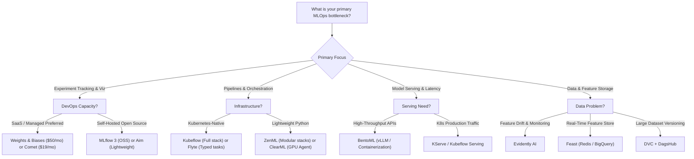

  

  
  
  
  
  
  
  
  

---

# 🚀 Awesome MLOps Platforms Ecosystem

> **A curated guide and market intelligence directory of premier SaaS platforms and production-proven open-source frameworks for Machine Learning Operations (MLOps), Experiment Tracking, GenAI Tracing, Model Registries, and AI Lifecycle Orchestration.**

---

## 📑 Table of Contents

- [🌐 Sector Overview & Market Dynamics](#-sector-overview--market-dynamics)
- [💼 SaaS & Hosted MLOps Platforms](#-saas--hosted-mlops-platforms)
  - [SaaS Platforms Comparison Table](#-saas-platforms-comparison-table-sorted-by-valuation--revenue)
  - [Detailed SaaS Profiles](#-detailed-saas-profiles)
- [🛠️ Open-Source GitHub Projects](#️-open-source-github-projects)
  - [Open-Source Ecosystem Table](#-open-source-ecosystem-table-sorted-by-github-stars)
  - [Detailed Open-Source Profiles](#-detailed-open-source-profiles)
- [🧭 Decision & Architecture Trade-off Guide](#-decision--architecture-trade-off-guide)
- [🤝 How to Contribute](#-how-to-contribute)
- [⚖️ Disclaimer](#️-disclaimer)
- [⭐ Star History](#-star-history)
- [💖 Support & Sponsorship](#-support--sponsorship)

---

## 🌐 Sector Overview & Market Dynamics

The global **MLOps market** was valued at approximately **$1.7 billion in 2023** and is projected to surge to between **$14 billion and $23 billion by 2030–2032**, expanding at an aggressive Compound Annual Growth Rate (CAGR) of **~38%–40%**, fueled by rapid enterprise Generative AI adoption, agentic workflows, and escalating governance demands.

The sector is currently **moderately fragmented** but undergoing rapid architectural consolidation. While enterprise hyperscalers (Databricks, AWS SageMaker, Microsoft Azure ML, Google Cloud Vertex AI) capture high-volume compute and data warehousing spend, independent best-of-breed platforms (Weights & Biases, Comet ML, ClearML) command profound developer mindshare in experiment visualization, model registries, and GenAI observability. Rather than a pure "winner-take-all" outcome, the market is cementing into a **hybrid composable paradigm**: enterprises standardize on an underlying cloud data/compute foundation while pairing it with specialized, API-driven tools for tracking, evaluation, and registry governance.

---

## 💼 SaaS & Hosted MLOps Platforms

### 📊 SaaS Platforms Comparison Table (Sorted by Valuation / Revenue)

| Rank | 🏢 Platform | 💰 Valuation / Revenue | 🏷️ Specific Starting Pricing | 🎁 Specific Free Tier / Trial Limits | 🎯 Primary Focus & Strengths |
| :---: | :--- | :--- | :--- | :--- | :--- |
| **#1** | **[Databricks Mosaic AI](https://www.databricks.com/product/machine-learning)** | **$43.0B Valuation** (~$2.4B+ ARR) | **$0.07 per DBU** (Standard tier pay-as-you-go; ~$99/mo baseline serverless compute) | **14-day free trial** with **$400** compute credits; Community Edition free forever (1 micro-cluster, 15GB RAM, 1 user) | Enterprise data lakehouse, Managed MLflow, Unity Catalog model governance, vector search |
| **#2** | **[Scale AI Platform](https://scale.com/)** | **$13.8B Valuation** (~$700M+ Revenue) | **$1,000/month** (Scale Donovan Starter tier) or **$0.02** per annotated unit | **30-day free trial** with **$250** in API credits and up to 5 project workspaces | End-to-end data engine, RLHF, GenAI evaluation suites, model fine-tuning & red teaming |
| **#3** | **[Weights & Biases](https://wandb.ai/)** | **$1.25B Valuation** (~$75M ARR) | **$50/user/month** (Team tier, billed annually) | **Free forever plan**: 5 model seats, **5 GB** tracked storage/mo, **1 GB** Weave traces/mo | Research visualization standard, hyperparameter sweeps, Weave LLM prompt tracing |
| **#4** | **[Domino Data Lab](https://domino.ai/)** | **$1.0B+ Valuation** (~$50M ARR) | **$1,500/month** (Domino Cloud Starter) or **$25,000/yr** Enterprise | **14-day free trial**: 1 user seat, **32GB RAM** maximum instance compute, sample ML environments | Regulated enterprise orchestration, multi-cloud compute governor, full reproducibility audit trail |
| **#5** | **[Comet ML](https://www.comet.com/)** | **$150M Valuation** (~$15M ARR) | **$19/user/month** (Pro plan, up to 10 users) | **Free forever (Community) plan**: 1 user, **100 GB** storage, 5 concurrent experiments; Opik Free: 10 seats, 25K spans/mo | Experiment tracking, model registry, Opik GenAI evaluation & tracing, compliance & audit logging |
| **#6** | **[ClearML Cloud](https://clear.ml/)** | **$150M Valuation** (~$12M ARR) | **$15/user/month** (Pro plan) + compute usage | **Free forever (Community) plan**: 3 users, **100 GB** artifact storage, **1 GB** metric events, **1M** API calls/mo | Hybrid GPU cluster autoscaling, orchestration pipelines, experiment tracker, CI/CD automation |
| **#7** | **[Neptune.ai](https://neptune.ai/)** | **$50M Valuation** (Acquired by OpenAI) | **$150/month** (Historical Team tier, 3 seats included) | **14-day free trial**: 100 GB artifact storage, 500 tracking hours *(new registrations closed post-acquisition)* | Lightweight high-throughput metadata logging for massive foundation model training runs |
| **#8** | **[DagsHub](https://dagshub.com/)** | **$20M Valuation** (~$2.5M ARR) | **$99/user/month** (Team tier billed annually, or $119/mo) | **Free forever plan**: 3 collaborators, **20 GB** managed storage (DVC/Git LFS), 100 tracked experiments | Git & DVC-native collaboration, hosted remote MLflow servers, dataset version control |

---

### 🔍 Detailed SaaS Profiles

#### 1. 🔷 [Databricks Mosaic AI & Managed MLflow](https://www.databricks.com/product/machine-learning)
* **Valuation / Financial Scale**: $43 Billion valuation (Series I); >$2.4 Billion ARR.
* **Pricing Breakdown**: Standard compute starting at **$0.07 per Databricks Unit (DBU)**. Serverless ML endpoints start at ~$0.07–$0.40/DBU depending on SKU. Typical small production deployment scales from **~$99 to $500+/month**.
* **Free Tier & Trial Limits**: **14-day full platform free trial** on AWS, Azure, or GCP with **$400 in cloud compute credits**. Permanent **Databricks Community Edition** provides free individual access with 1 driver micro-node (15 GB memory) and zero collaboration.
* **Strengths**: Zero infrastructure maintenance for MLflow tracking servers; direct lineage to Delta Lake tables; enterprise governance through Unity Catalog.
* **Best For**: Large-scale data engineering teams and enterprises already invested in Lakehouse architectures.

#### 2. ⚡ [Scale AI (GenAI Platform & Donovan)](https://scale.com/)
* **Valuation / Financial Scale**: $13.8 Billion valuation (Series F, May 2024); ~$700 Million+ annual revenue.
* **Pricing Breakdown**: **$1,000/month** base fee for Scale Donovan SaaS seats; data annotation from **$0.02 per labeled task**; customized enterprise SLAs.
* **Free Tier & Trial Limits**: **30-day sandbox trial** with **$250 in API credits**, up to 5 concurrent project workspaces, and synthetic test datasets.
* **Strengths**: Gold standard for RLHF (Reinforcement Learning from Human Feedback), red teaming, model safety benchmarking, and generative AI data pipelines.
* **Best For**: Frontier AI labs and enterprises fine-tuning LLMs requiring high-quality human-in-the-loop validation.

#### 3. 📈 [Weights & Biases (W&B)](https://wandb.ai/)
* **Valuation / Financial Scale**: $1.25 Billion valuation (Series C led by Felicis); ~$75 Million ARR.
* **Pricing Breakdown**: **$50 per user/month** (Team tier billed annually) or $60 monthly. Enterprise tiers add dedicated VPC endpoints and audit logs.
* **Free Tier & Trial Limits**: **Free Forever Personal Tier**: up to 5 model seats, **5 GB cloud storage per month**, and **1 GB data ingestion for Weave** LLM traces.
* **Strengths**: Industry-standard visualization interface; interactive parallel coordinates plots; seamless integration with PyTorch, Hugging Face, and Jax.
* **Best For**: Deep learning and GenAI research teams who prioritize rapid visual debugging of training runs.

#### 4. 🏛️ [Domino Data Lab](https://domino.ai/)
* **Valuation / Financial Scale**: $1.0+ Billion valuation; over $228 Million raised; ~$50 Million ARR.
* **Pricing Breakdown**: **$1,500/month** for Domino Cloud Starter tier; Enterprise contracts typically range from **$25,000 to $100,000+/year**.
* **Free Tier & Trial Limits**: **14-day free cloud trial**: 1 active seat, maximum compute cap of **32 GB RAM per instance**, pre-installed with PyTorch, TensorFlow, and RStudio.
* **Strengths**: Rigorous governance, reproducible container snapshots, and multi-cloud hardware abstraction.
* **Best For**: Heavily regulated organizations (financial services, healthcare, pharmaceuticals, defense).

#### 5. 🎯 [Comet ML](https://www.comet.com/)
* **Valuation / Financial Scale**: ~$150 Million valuation; $63 Million total funding; ~$15 Million ARR.
* **Pricing Breakdown**: **$19 per user/month** (Pro plan for up to 10 users, 500 GB storage); custom Enterprise quotes.
* **Free Tier & Trial Limits**: **Free Forever Community Plan**: 1 user, **100 GB storage**, 5 concurrent experiments. **Opik Cloud Free Tier**: 10 team seats, **25,000 spans/month**, and 60-day data retention.
* **Strengths**: Seamless transition from tabular ML tracking to GenAI prompt monitoring through Opik; rich model registry workflows.
* **Best For**: Enterprise teams seeking SOC 2 Type II compliance and combined ML/LLM observability.

#### 6. 🌐 [ClearML Cloud](https://clear.ml/)
* **Valuation / Financial Scale**: ~$150 Million valuation; $60 Million total funding; ~$12 Million ARR.
* **Pricing Breakdown**: **$15 per user/month** (Pro tier for up to 10 users) + transparent compute overages ($0.10/GB storage, $1/100K API calls).
* **Free Tier & Trial Limits**: **Free Forever Community Tier**: up to 3 users, **100 GB artifact storage**, **1 GB metric events**, and **1 Million API calls/month**.
* **Strengths**: Built-in GPU orchestration agent; autoscaling across AWS, Azure, and GCP clusters; automatic code/git snapshotting.
* **Best For**: Teams managing on-premise GPU clusters or multi-cloud training jobs who want integrated experiment tracking and scheduling.

#### 7. 🪐 [Neptune.ai](https://neptune.ai/) *(OpenAI)*
* **Valuation / Financial Scale**: ~$50 Million valuation; acquired by OpenAI in December 2025.
* **Pricing Breakdown**: **$150/month** base for historical Team tier (covering 3 seats and 200 GB artifact storage).
* **Free Tier & Trial Limits**: **14-day free trial**: 100 GB storage, 500 tracking hours *(public registrations transitioned to support OpenAI internal infrastructure)*.
* **Strengths**: Minimalist, hyper-performant metadata dashboard optimized for logging millions of data points without UI lag.
* **Best For**: Large-scale distributed pre-training runs with millions of steps.

#### 8. 📦 [DagsHub](https://dagshub.com/)
* **Valuation / Financial Scale**: ~$20 Million valuation; $3.5 Million seed funding; ~$2.5 Million ARR.
* **Pricing Breakdown**: **$99 per user/month** (Team plan billed annually) or **$119/month** pay-as-you-go.
* **Free Tier & Trial Limits**: **Free Forever Plan**: up to 3 collaborators, **20 GB managed storage** for data/models via DVC and Git LFS, and 100 tracked experiments.
* **Strengths**: Zero-configuration hosted MLflow tracking server paired with Git and DVC version control.
* **Best For**: Data-centric AI developers and open-source contributors managing large datasets alongside code.

---

## 🛠️ Open-Source GitHub Projects

### 📊 Open-Source Ecosystem Table (Sorted by GitHub Stars)

| Rank | 📦 Project | ⭐ Stars Badge (Stargazers Link) | 📜 License | 🎛️ Primary Function | 💡 Key MLOps Capabilities |
| :---: | :--- | :---: | :---: | :--- | :--- |
| **#1** | **[MLflow](https://github.com/mlflow/mlflow)** |  | Apache-2.0 | Full Lifecycle & LLMOps | Experiment tracking, model registry, GenAI hierarchical tracing, evaluation metrics |
| **#2** | **[DVC](https://github.com/iterative/dvc)** |  | Apache-2.0 | Data & Pipeline Versioning | Git-based dataset versioning, reproducible pipeline DAGs, cloud storage remotes |
| **#3** | **[Kubeflow](https://github.com/kubeflow/kubeflow)** |  | Apache-2.0 | Kubernetes ML Orchestration | Kubeflow Pipelines (KFP), distributed training operators (Katib), KServe model serving |
| **#4** | **[Ludwig](https://github.com/ludwig-ai/ludwig)** |  | Apache-2.0 | Declarative AI Framework | Low-code deep learning, LLM fine-tuning, Ray-distributed training, configuration-driven |
| **#5** | **[BentoML](https://github.com/bentoml/BentoML)** |  | Apache-2.0 | Model Serving & Deployment | High-performance inference runtimes, multi-model pipelines, container generation, vLLM runner |
| **#6** | **[Evidently](https://github.com/evidentlyai/evidently)** |  | Apache-2.0 | Model Monitoring & Evaluation | Data drift detection, regression/classification test suites, LLM quality evaluations |
| **#7** | **[Flyte](https://github.com/flyteorg/flyte)** |  | Apache-2.0 | Workflow Orchestration | Typed Python pipelines, Kubernetes execution engine, memoization, multi-tenant workflows |
| **#8** | **[Feast](https://github.com/feast-dev/feast)** |  | Apache-2.0 | Open-Source Feature Store | Low-latency online inference retrieval (Redis), point-in-time correct offline joins |
| **#9** | **[ClearML](https://github.com/allegroai/clearml)** |  | Apache-2.0 | Tracking & Orchestration | Auto-logging of code state, random seeds, hyperparameter sweeps, GPU scheduler daemon |
| **#10** | **[Aim](https://github.com/aimhubio/aim)** |  | Apache-2.0 | Self-Hosted Experiment Tracker | High-speed run visualization, 50x faster metric rendering, 100% self-contained Python backend |
| **#11** | **[ZenML](https://github.com/zenml-io/zenml)** |  | Apache-2.0 | Extensible MLOps Framework | Stack abstraction, vendor-agnostic pipeline orchestrator, metadata artifact tracking |

---

### 🔍 Detailed Open-Source Profiles

#### 1. 🥇 [MLflow](https://github.com/mlflow/mlflow) 
* **Architecture**: Python-based tracking server connecting to a relational metadata backend (PostgreSQL/MySQL) and S3/GCS/Azure blob artifact storage.
* **Key Components**:
  * **MLflow Tracking**: Log parameters, code versions, metrics, and output files with minimal code changes.
  * **MLflow Model Registry**: Central store with collaborative lifecycle staging (`Staging`, `Production`, `Archived`).
  * **MLflow 3 (GenAI Focus)**: Introduces `LoggedModel` as a first-class entity, hierarchical prompt tracing, and vector retrieval spans.
* **Operational Considerations**: Requires managing your own PostgreSQL database and object storage; default SQLite backend is unsuitable for concurrent production writes.
* **Best Fit**: Teams looking for an unencumbered, battle-tested open-source standard for tracking and model registries.

#### 2. 🥈 [DVC (Data Version Control)](https://github.com/iterative/dvc) 
* **Architecture**: Command-line tool extending Git to track pointer files representing large datasets and models stored in remote cloud buckets (S3, GCS, Azure Blob, SSH).
* **Key Components**:
  * **Data Versioning**: Tracks gigabytes/terabytes of files using Git commit hashes and content-addressable metadata.
  * **DVC Pipelines (`dvc.yaml`)**: Defines DAGs with automatic caching of intermediate stage outputs.
* **Operational Considerations**: Lightweight CLI with zero persistent daemons or background databases required.
* **Best Fit**: Data engineering and ML teams requiring deterministic data reproducibility without vendor lock-in.

#### 3. 🥉 [Kubeflow](https://github.com/kubeflow/kubeflow) 
* **Architecture**: Comprehensive Kubernetes-native cloud-agnostic ML deployment platform.
* **Key Components**:
  * **Kubeflow Pipelines (KFP)**: Multi-step pipeline compilation and execution using Argo Workflows.
  * **Katib**: Hyperparameter tuning and neural architecture search operator.
  * **KServe Integration**: Serverless model inference with traffic routing, canaries, and auto-scaling to zero.
* **Operational Considerations**: High operational threshold; requires dedicated DevOps/Kubernetes engineering capabilities.
* **Best Fit**: Large enterprises with established Kubernetes infrastructure and dedicated platform operations teams.

#### 4. 🧠 [Ludwig](https://github.com/ludwig-ai/ludwig) 
* **Architecture**: Declarative framework allowing users to define deep learning architectures, LLM fine-tuning, and evaluation pipelines via YAML configs.
* **Key Components**:
  * **Declarative Configuration**: Zero-code specification for encoders, combiners, and decoders.
  * **Distributed Ray Backend**: Seamless scaling from single-GPU laptop training to multi-node clusters.
* **Operational Considerations**: Excellent for democratizing ML development across junior engineers and data scientists.
* **Best Fit**: Rapid prototyping, structured tabular/text/image modeling, and parameter-efficient fine-tuning (PEFT/LoRA).

#### 5. 🚀 [BentoML](https://github.com/bentoml/BentoML) 
* **Architecture**: High-throughput model serving architecture that unifies inference APIs, dynamic batching, and containerization.
* **Key Components**:
  * **Runner Architecture**: Isolates compute-intensive model inference from web request handling.
  * **Bento packaging**: Self-contained runnable archives containing model weights, dependencies, and environment configurations.
* **Operational Considerations**: Extremely fast startup times with native vLLM and Hugging Face integration.
* **Best Fit**: Moving models from Jupyter notebooks into resilient, auto-scaling production microservices.

#### 6. 📊 [Evidently](https://github.com/evidentlyai/evidently) 
* **Architecture**: Evaluation and monitoring engine that generates interactive reports, JSON test suites, and live streaming metrics.
* **Key Components**:
  * **Data & Target Drift**: Statistical tests (Wasserstein distance, KS test) detecting production distribution shifts.
  * **LLM Evaluation**: Evaluates hallucinations, toxicity, sentiment, and context relevance.
* **Operational Considerations**: Can run as an ad-hoc Python library or deploy as a persistent self-hosted monitoring server.
* **Best Fit**: Preventing silent model decay and validating data quality across ingestion and inference pipelines.

#### 7. ✈️ [Flyte](https://github.com/flyteorg/flyte) 
* **Architecture**: Production-grade, Kubernetes-native workflow engine created at Lyft; built with strongly typed tasks and workflows.
* **Key Components**:
  * **Type-Safe Task Contracts**: Enforces strict input/output signatures across distributed pipeline steps.
  * **Containerized Execution**: Every task runs in its own isolated container with individualized GPU/CPU resource requests.
* **Operational Considerations**: Unmatched reliability for mission-critical pipelines; requires Kubernetes cluster administration.
* **Best Fit**: Enterprise ML teams executing complex, multi-tenant distributed training and batch processing pipelines.

#### 8. 🍽️ [Feast](https://github.com/feast-dev/feast) 
* **Architecture**: Standard open-source feature store managing dual storage layers: low-latency online stores (Redis, DynamoDB) and analytical offline stores (Snowflake, BigQuery, DuckDB).
* **Key Components**:
  * **Point-in-Time Joins**: Eliminates data leakage during model training.
  * **Consistent Feature Serving**: Ensures features computed during training match inference retrieval exactly.
* **Operational Considerations**: Modular and customizable; integrates with standard data warehouses.
* **Best Fit**: Real-time recommendation systems, fraud detection, and predictive scoring models.

#### 9. 🤖 [ClearML OSS](https://github.com/allegroai/clearml) 
* **Architecture**: All-in-one suite providing tracking server, web UI, dataset manager, and distributed compute daemon (`clearml-agent`).
* **Key Components**:
  * **Zero-Code Integration**: Automatically tracks script arguments, Git commit hashes, and environment variables.
  * **ClearML Agent**: Lightweight worker agent that pulls tasks from queues and executes them on remote GPU nodes.
* **Operational Considerations**: Multi-service self-hosted stack uses Docker Compose / Helm (PostgreSQL, MongoDB, ElasticSearch, Web UI).
* **Best Fit**: Teams wanting both tracking and cluster orchestration in a single unified open-source package.

#### 10. 🎯 [Aim](https://github.com/aimhubio/aim) 
* **Architecture**: Ultra-lightweight experiment tracker built on top of a custom RocksDB-backed storage engine.
* **Key Components**:
  * **High-Performance UI**: Renders tens of thousands of metric curves and run comparisons smoothly.
  * **Embedded Python API**: Can be embedded directly into local scripts or served as a shared team server.
* **Operational Considerations**: Focuses strictly on experiment tracking; does not include built-in model serving or cluster scheduling.
* **Best Fit**: Solo practitioners, academic labs, and engineering teams that want a snappy, self-hosted UI with zero overhead.

#### 11. 🧩 [ZenML](https://github.com/zenml-io/zenml) 
* **Architecture**: Extensible MLOps orchestration framework that decouples pipeline code from the underlying infrastructure stack.
* **Key Components**:
  * **MLOps Stacks**: Swap out artifact stores (S3), orchestrators (Airflow/Kubeflow), and tracking backends (MLflow/W&B) with simple config flags.
  * **Pipeline Lineage**: Automatically logs step metadata, inputs, and outputs.
* **Operational Considerations**: Highly portable; avoids lock-in to any single cloud vendor or tool.
* **Best Fit**: Teams building modular pipelines who want the flexibility to switch cloud providers and compute backends effortlessly.

---

## 🧭 Decision & Architecture Trade-off Guide

---

## 🤝 How to Contribute

Contributions, reviews, and updates are warmly welcomed! Please follow these steps:

1. **Fork** this repository.
2. **Create a branch**: `git checkout -b feature/add-new-platform`.
3. **Format entries**:
   - Provide verified starting tier pricing and specific free tier limits.
   - For open-source tools, include the repository URL and shields social star badge.
   - Maintain objective, factual technical descriptions.
4. **Submit a Pull Request** with a concise summary of the addition or revision.

---

## ⚖️ Disclaimer

* This repository is an independent, community-curated research directory. Mentions do not constitute commercial endorsement.
* Pricing tiers, storage allowances, and platform terms are subject to change by respective vendors. Verify current specifications directly on official vendor websites before provisioning production infrastructure.

---

## ⭐ Star History

---

## 💖 Support & Sponsorship

If this curated guide helps accelerate your MLOps engineering roadmap, please consider supporting the project:

- 🌟 **Star** the repository to boost visibility for the AI community.
- 🍴 **Fork** and contribute updates to keep benchmarks fresh.
- 📢 **Share** with your engineering network and colleagues.
- ☕ **Support the maintainer**: Buy a coffee or sponsor development via the [GitHub Sponsors Dashboard](https://github.com/sponsors/ishandutta2007).

---

  <b>Built with ❤️ for ML Engineers, Platform Architects &amp; AI Researchers worldwide.</b> 
  Explore more curated lists on <a href="https://github.com/ishandutta2007/Awesome-Awesome-Awesome">Awesome-Awesome-Awesome</a>.

